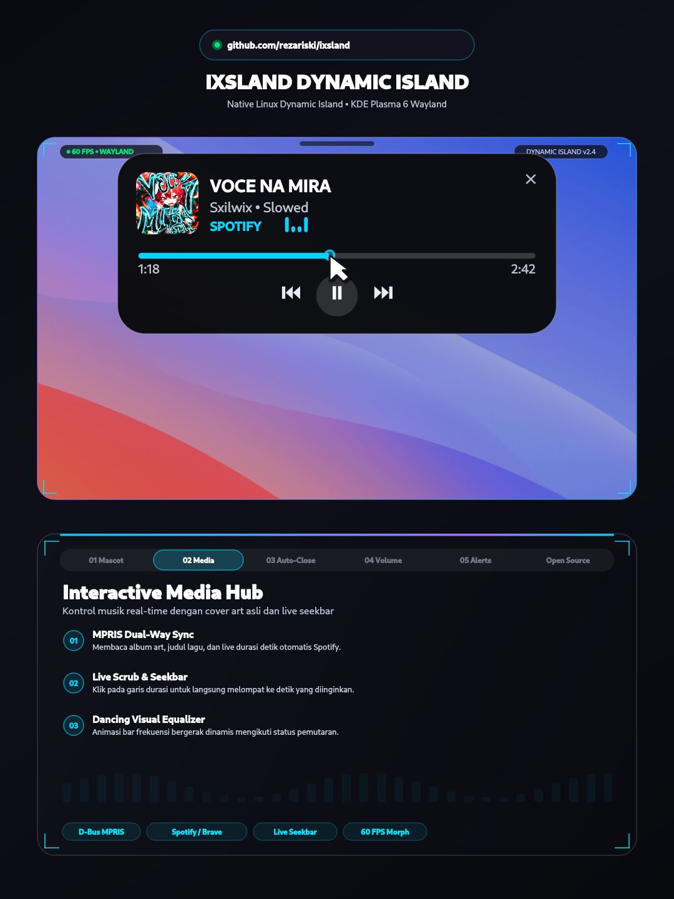
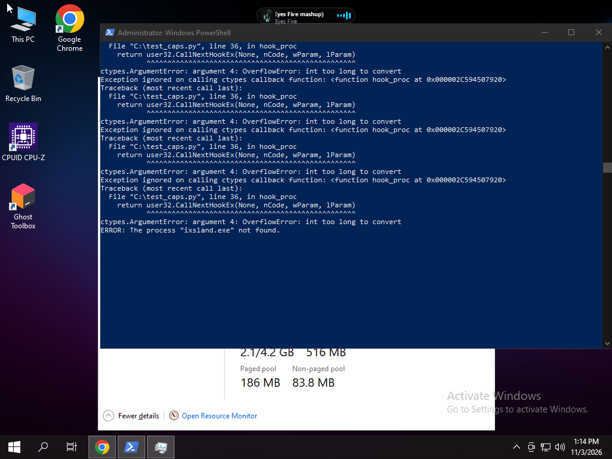
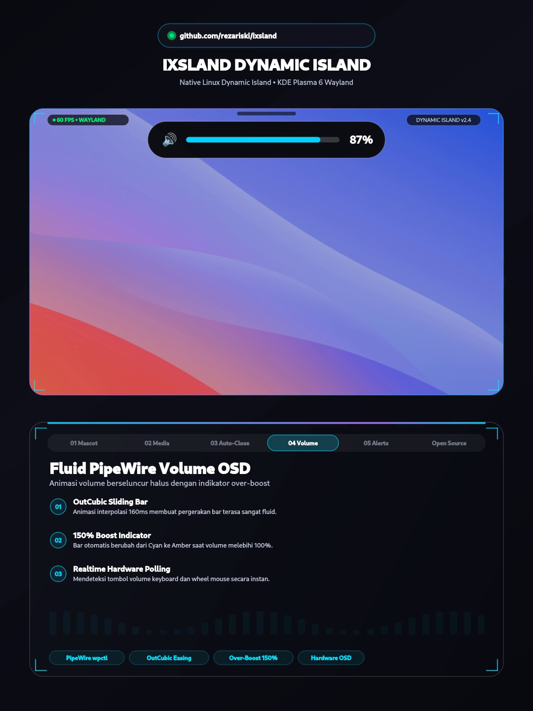
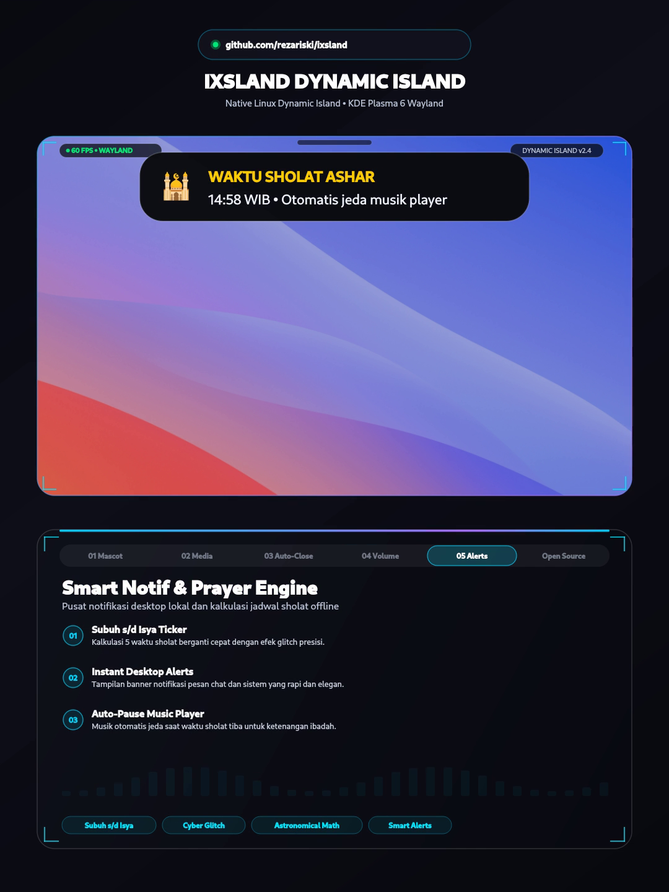

<div align="center">

# 🏝️ ixsland — Dynamic Island (Linux/Windows)

**A blazing-fast, buttery-smooth Dynamic Island crafted natively for Linux and Windows 10/11 (64-bit).**  
*Zero Electron bloat. Pure 60 FPS PyQt6 native magic.*

<br/>



<br/>

<p align="center">
  <a href="https://github.com/rezariski/ixsland/releases/latest">
    
  </a>
  
  
  
  
  
</p>

<p align="center">
  <a href="#-1-linux-edition"><code>[ 🐧 LINUX GUIDE ]</code></a> &nbsp;•&nbsp;
  <a href="#-2-windows-edition-windows-10--11-64-bit"><code>[ 🪟 WINDOWS GUIDE ]</code></a> &nbsp;•&nbsp;
  <a href="#-interactive-demo-showcase-linux--windows"><code>[ 🧪 DEMO SHOWCASE ]</code></a> &nbsp;•&nbsp;
  <a href="#-feature-walkthrough"><code>[ ✨ FEATURES ]</code></a> &nbsp;•&nbsp;
  <a href="#-configuration"><code>[ ⚙️ CONFIG ]</code></a> &nbsp;•&nbsp;
  <a href="#-treat-me-a-coffee"><code>[ ☕ DONATE ]</code></a>
</p>

</div>

---

## 📦 Dua Pilihan Platform: Linux & Windows (Linux/Windows)

`ixsland` hadir secara native untuk dua ekosistem sistem operasi utama dengan arsitektur yang dirancang khusus:
1. **Linux (Wayland / X11)**: Integrasi murni PipeWire `wpctl`, D-Bus MPRIS, KDE Plasma 6 KWin / Wayland layer.
2. **Windows (Windows 10 & Windows 11 64-bit)**: Integrasi Windows CoreAudio API, WinRT GSMTC Media Control, Low-Level Hardware Hooks, dan Standalone Installer `Setup.exe`.

---

## 🐧 1. Linux Edition

Pemasangan pada Linux membutuhkan waktu kurang dari 30 detik. Widget otomatis diletakkan tepat di bagian tengah atas monitor utama Anda.

### Dependensi Sistem

```bash
# Arch Linux / CachyOS / Manjaro
sudo pacman -S python python-pyqt6 pipewire wireplumber qt6-declarative

# Ubuntu / Debian
sudo apt update && sudo apt install python3 python3-pyqt6 pipewire wireplumber

# Fedora
sudo dnf install python3 python3-pyqt6 pipewire wireplumber
```

### Pasang & Jalankan

```bash
git clone https://github.com/rezariski/ixsland.git
cd ixsland
chmod +x install.sh
./install.sh
```

Installer akan memasang berkas ke `~/.local/share/ixsland/`, mendaftarkan unit systemd user, dan langsung menyalakan Dynamic Island.

### Manajemen Layanan (Linux)

```bash
systemctl --user status ixsland.service   # Cek status
systemctl --user restart ixsland.service  # Restart
journalctl --user -u ixsland -f           # Live log
./uninstall.sh                            # Hapus instalasi
```

---

## 🪟 2. Windows Edition (Windows 10 & 11 64-bit)

Mendukung penuh arsitektur **Windows 10 (64-bit, 1903+)** dan **Windows 11 (64-bit)**.

<div align="center">
  
  <p><em>Tangkapan layar ixsland aktif di desktop Windows 10 Pro 64-bit dengan pemutar musik tersinkronisasi.</em></p>
</div>

### Opsi A: Standalone Setup Installer (Paling Praktis, Tanpa Perlu Python)
1. Buka folder [`windows/`](./windows/) atau unduh berkas **`Setup.exe`** (38 MB).
2. Jalankan `Setup.exe` dan ikuti wizard grafis yang disediakan:
   - Pilih direktori instalasi (default: `C:\ixsland`).
   - Opsi membuat shortcut desktop & autostart saat Windows boot.
3. Klik **Pasang Sekarang**. `ixsland` langsung aktif di monitor Anda tanpa memerlukan dependensi luar.

### Opsi B: Menjalankan dari Kode Sumber (Developer)
Pastikan Anda menggunakan Python 3.10+ (64-bit):
```cmd
cd windows
pip install PyQt6 pycaw comtypes winsdk
python ixsland_win.py
```

---

## 🧪 Interactive Demo Showcase (Linux & Windows)

Ingin melihat simulasi seluruh modul animasi, HUD, dan notifikasi beraksi secara berurutan? Gunakan showcase runner bawaan:

### Pada Linux:
```bash
python3 ~/.local/share/ixsland/run-demo.py
```

### Pada Windows 10 / Windows 11:
- **Cara Instan (Tanpa Python)**: Klik ganda file **`windows/run-demo.bat`** atau jalankan via PowerShell:
  ```powershell
  powershell -ExecutionPolicy Bypass -File .\windows\run-demo.ps1
  ```
- **Via Python**:
  ```cmd
  python windows/run_demo.py
  ```

---

## 🚀 Feature Walkthrough

### 01. 🤖 Interactive OLED Mascot with Gaze Physics
<div align="center">
  
</div>

- **Mathematical Gaze Tracking**: Pupil mata robot mengikuti koordinat kursor mouse Anda secara real-time dengan pantulan 3D parallax.
- **Natural Blink & Blush Joy**: Berkedip alami setiap 3.8s dan tersenyum malu-senang (`^  ^`) dengan rona pipi pink saat kursor didekatkan.
- **Smart Idle Sleep Engine**: Jika kursor tidak bergerak selama 22 detik, maskot tertidur pulas dengan animasi `zZ`.

---

### 02. 🎵 Real-Time Media Hub & Live Seekbar
<div align="center">
  
</div>

- **Sinkronisasi Dua Arah**: Membaca cover album, judul lagu, musisi, dan status putar dari Spotify, Chrome, Edge, Firefox via MPRIS (Linux) atau GSMTC (Windows).
- **Click-to-Seek Scrubbing**: Progress bar durasi berjalan detik demi detik. Klik di posisi mana saja untuk lompat ke detik yang diinginkan.
- **Equalizer Spektrum 120 BPM**: Batang frekuensi equalizer menari dinamis mengikuti ritme audio.

---

### 03. 🧲 Smart Auto-Collapse & Top Notch Docking
- **Penciutan Otomatis**: Saat mouse menjauh dari area island, Dynamic Island secara halus melipat kembali ke ukuran semula.
- **Top Notch Mode**: Opsi mengecilkan tampilan menjadi notch tipis di pucuk layar monitor untuk area kerja yang lebih bersih.
- **120ms Debounce Shield**: Pergerakan kursor yang melintas cepat tidak akan memicu kedipan yang tidak disengaja.

---

### 04. 🔊 Fluid Volume OSD & 150% Overboost Warning
<div align="center">
  
</div>

- **Animasi Sangat Halus**: Perubahan level volume meluncur dengan kurva easing `OutCubic`.
- **Indikator Api Overboost**: Saat volume melebihi 100% (hingga batas boost 150%), aksen bar berubah menjadi jingga membara dengan ikon api `🔥`.

---

### 05. 🔠 Shift Lock & Caps Lock Persistent HUD
- **Indikator Aktif Menetap**: Saat Caps Lock / Shift Lock aktif, label kuning `CAPS LOCK ON` tetap menyala konsisten selama mengetik tanpa flicker atau kolaps prematur.
- **Transisi Halus Saat Nonaktif**: Saat dimatikan, indikator bertransisi elastis ke warna abu-abu `CAPS LOCK OFF` selama 1.5 detik lalu melipat otomatis kembali ke jam/media.
- **Deteksi Hardware Instan**: Membaca status register keyboard langsung pada event key release (`WM_KEYUP`).

---

### 06. 🕌 Offline Astronomical Prayer Time Engine & Smart Alerts
<div align="center">
  
</div>

- **Matematika Astronomi 100% Offline**: Menghitung jadwal sholat (Subuh, Dzuhur, Ashar, Maghrib, Isya) secara lokal berdasarkan deklinasi matahari tanpa ketergantungan API pihak ketiga.
- **Auto-Pause Music Player**: Otomatis menghentikan pemutaran musik saat adzan berkumandang.
- **Desktop Chat Alerts**: Spanduk notifikasi elegan untuk pesan chat masuk (WhatsApp, Telegram, Discord).

---

## ⚙️ Configuration

Berkas konfigurasi tersimpan pada:
- **Linux**: `~/.local/share/ixsland/config.json`
- **Windows**: `C:\ixsland\config.json` (atau di folder aplikasi)

```json
{
  "target_screen": "primary",
  "top_margin": 16,
  "latitude": -6.2088,
  "longitude": 106.8456,
  "timezone": 7.0,
  "city": "Jakarta (WIB)",
  "pause_music_on_adzan": true,
  "enable_mascot": true
}
```

| Opsi | Tipe | Penjelasan |
|---|---|---|
| `target_screen` | `string` | `"primary"` (monitor utama), atau nama konektor (`"HDMI-1"`, `"eDP-1"`). |
| `top_margin` | `integer` | Jarak dalam pixel dari tepi atas layar monitor (default: `16`). |
| `latitude` / `longitude` | `float` | Titik koordinat bumi untuk perhitungan hisab waktu sholat. |
| `timezone` | `float` | Selisih waktu UTC (misal `7.0` untuk WIB, `8.0` untuk WITA). |
| `pause_music_on_adzan` | `boolean` | `true` untuk menjeda musik otomatis saat masuk waktu sholat. |
| `enable_mascot` | `boolean` | `true` untuk mengaktifkan maskot robot OLED interaktif. |

---

<div align="center">

## ☕ Treat Me a Coffee!

Jika Anda menyukai proyek Dynamic Island `ixsland` ini di Linux maupun Windows dan ingin mendukung pengembangannya, donasi secangkir kopi sangat berarti! 🚀

<br/>

<a href="https://saweria.co/rezariski42" target="_blank">
  
</a>

<br/>
<br/>

**Saweria Tip Link**: [saweria.co/rezariski42](https://saweria.co/rezariski42)

<br/>

<sub>Crafted with passion by **Reza Rizki** • Built for Linux & Windows (Linux/Windows) • Licensed under GPL-3.0</sub>

</div>
