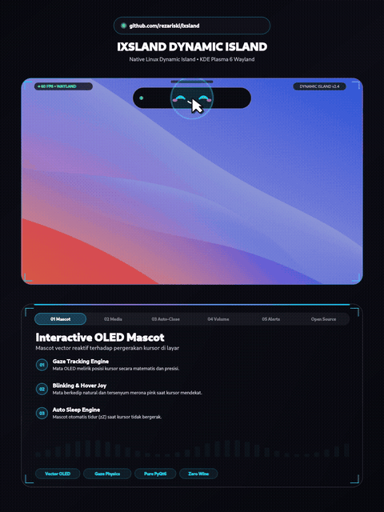

<div align="center">

# 🏝️ ixsland — Dynamic Island for Linux

**A blazing-fast, buttery-smooth Dynamic Island crafted natively for Linux desktop.**  
*Zero Wine. Zero Electron bloat. Pure 60 FPS PyQt6 & Wayland native magic.*

<br/>


<br/>

<p align="center">
  <a href="https://github.com/rezariski/ixsland/releases/latest">
    
  </a>
  
  
  
  
  
</p>

<p align="center">
  <a href="https://github.com/rezariski/ixsland/releases/latest"><code>[ 📦 DOWNLOAD v1.0.0 ]</code></a> &nbsp;•&nbsp;
  <a href="#-quick-start"><code>[ ⚡ QUICK START ]</code></a> &nbsp;•&nbsp;
  <a href="#-feature-walkthrough"><code>[ ✨ FEATURES ]</code></a> &nbsp;•&nbsp;
  <a href="#-configuration"><code>[ ⚙️ CONFIG ]</code></a> &nbsp;•&nbsp;
  <a href="#-interactive-demo"><code>[ 🧪 DEMO ]</code></a> &nbsp;•&nbsp;
  <a href="#-treat-me-a-coffee"><code>[ ☕ DONATE ]</code></a>
</p>

</div>

---

## ⚡ Quick Start

Installing `ixsland` takes less than 30 seconds. By default, it targets and centers right at the top of your **primary main monitor**.

### 1. Grab Dependencies

```bash
# Arch Linux / CachyOS / Manjaro
sudo pacman -S python python-pyqt6 pipewire wireplumber qt6-declarative

# Ubuntu / Debian
sudo apt update && sudo apt install python3 python3-pyqt6 pipewire wireplumber

# Fedora
sudo dnf install python3 python3-pyqt6 pipewire wireplumber
```

### 2. Clone & Install

```bash
git clone https://github.com/rezariski/ixsland.git
cd ixsland
chmod +x install.sh
./install.sh
```

That's literally it! The installer copies files to `~/.local/share/ixsland/`, creates a systemd user unit, and boots up the island immediately.

### Managing the Service

```bash
# Check running status
systemctl --user status ixsland.service

# Restart
systemctl --user restart ixsland.service

# View live logs
journalctl --user -u ixsland -f

# Uninstall cleanly anytime
./uninstall.sh
```

---

<div align="center">
  <h2>✨ Live Demo in Action</h2>
  
</div>

---

## 🚀 Feature Walkthrough

### 01. 🤖 Interactive OLED Mascot with Gaze Physics
<div align="center">
  
</div>

- **Mathematical Gaze Tracking**: The vector mascot eyes dynamically follow your mouse cursor anywhere on the screen in real time with authentic 3D parallax glints.
- **Natural Blink & Blush Joy**: Features natural micro-blinks every 3.8s and blushes a joyous hot-pink with a happy curved smile whenever you hover your cursor near the island.
- **Smart Idle Sleep Engine**: Leave your desk? After 22 seconds of zero mouse movement, the mascot gently shuts its eyes with animated floating `zZ` indicators to save focus.

---

### 02. 🎵 Real-Time MPRIS Media Hub & Live Seekbar
<div align="center">
  
</div>

- **Two-Way MPRIS Sync**: Reads album art, track title, artist name, and live play/pause state from Spotify, Brave, Chrome, Firefox, or any Linux MPRIS player.
- **Click-to-Seek Scrubbing**: Real-time progress bar ticking second-by-second. Click anywhere on the duration timeline to jump instantly to that timestamp.
- **120 BPM Dancing Equalizer**: Fluid frequency spectrum bars bouncing synchronously to active audio playback.
- **Seamless Morphing**: Expands smoothly from a compact 180px pill into a full 380px music card using fluid `OutBack` easing.

---

### 03. 🧲 Smart Auto-Collapse (Zero Click Hassle)
- **Automatic Mouse Exit Snapping**: No need to fiddle with tiny close buttons. Once you finish picking your track or scrubbing, just move your cursor outside the island area and it smoothly folds back into compact view.
- **120ms Debounce Shield**: Moving cursor across the screen fast won't cause annoying accidental flickering.
- **Permanent KWin Anchor**: Built using a fixed Wayland toplevel canvas with transparent input masks — meaning zero window manager repositioning lag or vertical jitter.

---

### 04. 🔊 Fluid PipeWire Volume OSD & 150% Boost Warning
<div align="center">
  
</div>

- **Silky Interpolation**: Volume changes glide across the screen with a 160ms `OutCubic` animation curve.
- **Hardware Event Polling**: Detects volume keys, headset buttons, and mouse wheel input instantaneously via PipeWire's `wpctl`.
- **Over-Boost Fire Indicator**: When pushing audio past 100% (up to 150% boost), the sliding bar shifts dynamically from neon cyan into an amber blaze with a `🔥` badge alert.

---

### 05. 🕌 Offline Astronomical Prayer Time Engine & Smart Alerts
<div align="center">
  
</div>

- **100% Offline Solar Math**: Calculates Subuh, Dzuhur, Ashar, Maghrib, and Isya astronomical schedules locally using solar declination equations — zero external API dependency or latency.
- **Auto-Pause Music Player**: Automatically pauses music playback as soon as prayer call starts so you never miss worship peace.
- **Desktop System Alerts**: Beautiful pill banner for incoming chat messages (WhatsApp, Discord, Telegram) and system alerts.

---

## ⚙️ Configuration

Your configuration lives at `~/.local/share/ixsland/config.json`. Tweak coordinates, screen targets, or prayer location easily:

```json
{
  "target_screen": "primary",
  "top_margin": 16,
  "latitude": -6.2088,
  "longitude": 106.8456,
  "timezone": 7.0,
  "city": "Jakarta (WIB)",
  "pause_music_on_adzan": true
}
```

| Setting | Type | Description |
|---|---|---|
| `target_screen` | `string` | `"primary"` (default main monitor), or specify connector name (`"eDP-1"`, `"HDMI-A-1"`). |
| `top_margin` | `integer` | Distance in pixels from the top edge of your screen (default: `16`). |
| `latitude` / `longitude` | `float` | Coordinates for the offline astronomical prayer engine. |
| `timezone` | `float` | UTC offset (e.g. `7.0` for WIB, `8.0` for WITA). |
| `pause_music_on_adzan` | `boolean` | Set `true` to auto-pause Spotify/media when Adzan begins. |

---

## 🧪 Interactive Demo Showcase

Want to test every single animation state back-to-back? Run the built-in showcase suite:

```bash
python3 ~/.local/share/ixsland/run-demo.py
```

This triggers every feature (Idle clock, Mascot smile, Subuh s/d Isya alerts, Spotify seek, Volume OSD 85% & 135%, WhatsApp chat banner) with live transitions and auto-collapses.

---

## 🛠️ Architecture & Under the Hood

- **Wayland Native**: Runs as an unmanaged overlay toplevel on KDE Plasma 6 KWin.
- **Zero XWayland Overhead**: Uses pure Qt6 Wayland platform integration.
- **D-Bus IPC Control**: Exposes `org.ixsland.Island` interface on session bus for seamless scripting with `qdbus6`.
- **Pure Vector Rendering**: Every pill, curve, eye reflection, and equalizing bar is drawn in realtime with anti-aliased `QPainter`.

---

<div align="center">

## ☕ Treat Me a Coffee!

If you love having this slick Dynamic Island on your Linux setup and want to support continued development, feel free to drop a tip! Every coffee counts! 🚀

<br/>

<a href="https://saweria.co/rezariski42" target="_blank">
  
</a>

<br/>
<br/>

**Saweria Tip Link**: [saweria.co/rezariski42](https://saweria.co/rezariski42)

<br/>

<sub>Crafted with passion by **Reza Rizki** • Made for the Linux community • Licensed under GPL-3.0</sub>

</div>
